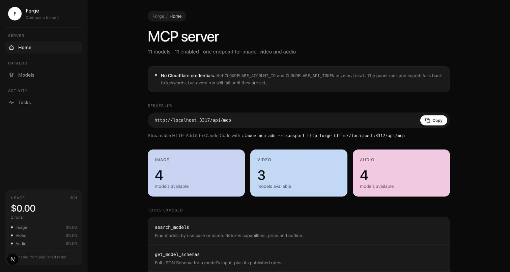
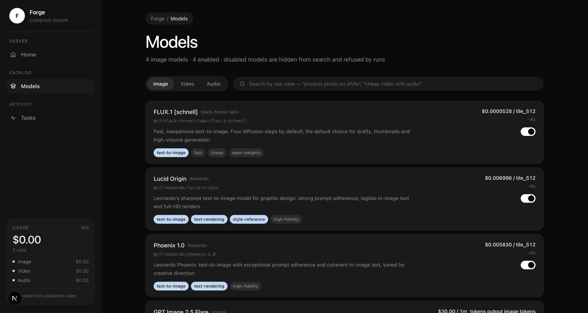
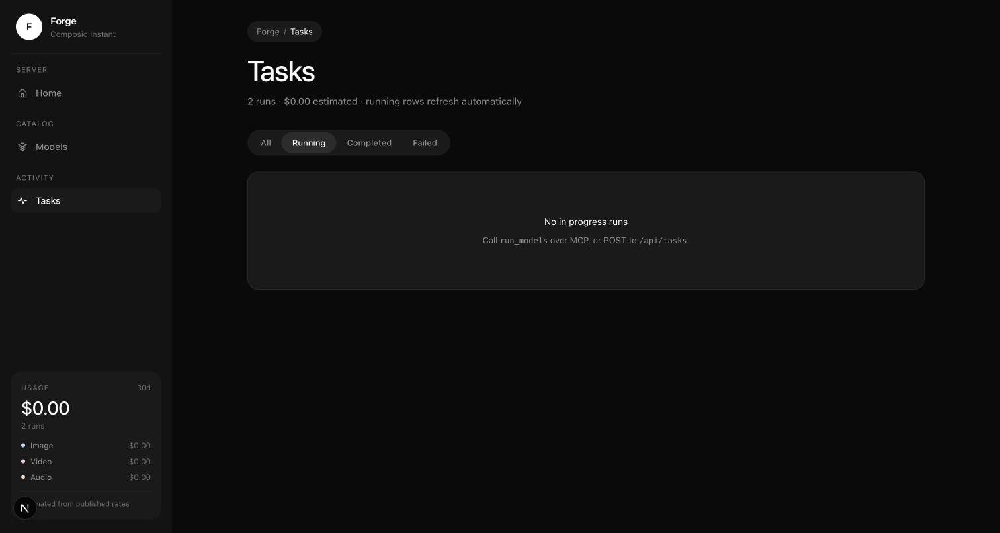

# Composio Sequel

One MCP server for image, video and audio generation models, with a control
panel to enable, price and watch them.

What Composio did for SaaS tools, this does for media models: search by use
case, get a schema back, generate. Models run through Cloudflare's unified AI
endpoint, which fronts both Workers AI and partner models behind AI Gateway.



## Layout

```
apps/control-panel      Next.js app — dashboard + MCP endpoint + REST API
packages/core           Model factories, registry, pricing, embeddings, storage
packages/models         One file per model, declared with the core factories
spec/models.types.ts    The wider `composio.models` surface this grows into
research/               Market and model research behind the design
```

## Quick start

```bash
pnpm install
cp apps/control-panel/.env.example apps/control-panel/.env.local
# set CLOUDFLARE_ACCOUNT_ID and CLOUDFLARE_API_TOKEN
pnpm dev                      # http://localhost:3000
```

The panel boots without credentials — model search falls back to keyword
matching and every run fails with a clear message. Set the two Cloudflare
variables and everything works.

### API token permissions

Create the token at **My Profile → API Tokens → Create Token**. The quickest
route is the dashboard's own **Workers AI** template (Workers AI → Use REST API
→ Create a Workers AI API Token), which prefills everything.

Rolling your own, grant **Account → Workers AI → Edit** (Edit implies Read, and
Cloudflare's own guide asks for both).

That single permission covers every model this app runs — `@cf/` Workers AI
models *and* partner models like Veo, Wan and Grok. Both go through
`/accounts/{id}/ai/run`, and the docs are explicit:

> All `/accounts/{account_id}/ai/*` endpoints require the Workers AI permission.
> This applies to third-party models and to Workers AI (`@cf/`) models. A token
> that holds only an `AI Gateway` permission returns `401` with error code
> `10000`.

So do **not** reach for the `AI Gateway` permission for inference — it governs
`/ai-gateway/*` (gateway config, logs, routes) and is only needed if you manage
gateways through the API. Setting `CLOUDFLARE_AI_GATEWAY` to route through a
named gateway does not require it.

**Partner models need account credits.** Veo, Wan, Grok Imagine, MiniMax and
GPT Image bill through unified billing, so load credits before calling them or
the run fails regardless of token scope.

**R2 uses different credentials.** The `R2_ACCESS_KEY_ID` / `R2_SECRET_ACCESS_KEY`
pair is an S3-compatible access key from **R2 → Manage R2 API Tokens**, not the
API token above. `R2_PUBLIC_BASE_URL` is optional — set it only if the bucket
has public access enabled. Left unset, reads are handed out as presigned GET
URLs valid for 7 days, so the bucket can stay private and a provider can still
fetch an input you uploaded.

## The five tools

| Tool | Does |
| --- | --- |
| `search_models` | Find models by use case or name. Returns capabilities, price, latency, outline. |
| `get_model_schemas` | Full JSON Schema for a model's input, plus its published rates. |
| `get_upload_url` | A URL to PUT a file to, and the URL it will be readable from. |
| `run_models` | Run a model. Image and audio inline; video returns `in_progress`. |
| `list_tasks` | Status, results and cost for recent runs. |

Connect it:

```bash
claude mcp add --transport http sequel http://localhost:3000/api/mcp
```

Or call it directly — it is stateless JSON-RPC over Streamable HTTP:

```bash
curl -s localhost:3000/api/mcp -H 'content-type: application/json' \
  -d '{"jsonrpc":"2.0","id":1,"method":"tools/call","params":{
        "name":"search_models",
        "arguments":{"type":"video","query":"cheap vertical clip with sound"}}}'
```

## Defining a model

A model is declared once, with its zod input schema, capabilities, published
rates and a `run`. Everything downstream — the MCP tools, the panel, the
embedding index, the cost estimator — reads that one declaration.

```ts
// packages/models/src/video/wan-3-0.ts
export const wan30 = createVideoModel({
  id: 'alibaba/wan-3.0',
  provider: 'alibaba',
  name: 'Wan 3.0',
  description: 'Cinematic text-to-video at 480p–1080p, up to 15 seconds.',
  capabilities: ['text-to-video'],
  tags: ['cheap', 'open-weights'],
  keywords: ['cheap video', 'social clip', 'vertical video', 'tiktok'],
  rates: [
    { unit: 'second', usd: '0.05', qualifier: '@480p' },
    { unit: 'second', usd: '0.10', qualifier: '@720p' },
    { unit: 'second', usd: '0.20', qualifier: '@1080p' },
  ],
  runtime: 'ai-gateway',
  async: true,            // returns in_progress; caller polls list_tasks
  etaSeconds: 75,
  input: z.object({
    prompt: z.string().min(1).max(2500),
    resolution: z.enum(['480P', '720P', '1080P']).default('720P'),
    duration: z.number().int().min(1).max(15).default(5),
  }),
  run: async (input, ctx) => ({
    kind: 'video',
    assets: await collectAssets(
      await ctx.ai.run({ model: 'alibaba/wan-3.0', runtime: 'ai-gateway', input }),
      ctx,
      { mime: 'video/mp4', ext: 'mp4' },
    ),
  }),
});
```

Set `requiresByok: true` when Cloudflare will not bill a model through unified
billing — Sequel then lists it but refuses the run up front rather than paying for
a round trip that the provider rejects.

Add the export to `packages/models/src/index.ts` and it appears in the panel,
the MCP tool surface and the search index on next boot. There is no second
registry to update.

`createImageModel`, `createVideoModel` and `createAudioModel` pin the output
type, so a video model cannot accidentally return images. `createModel` takes
the modality explicitly when you need it.

### Rate qualifiers carry meaning

`selectRate` matches the request against each rate's `qualifier`, so a Veo clip
asked for with `generate_audio: true` is priced at the audio rate — $0.40/s
rather than $0.20/s. Qualifiers are matched on the resolution string and the
word `audio`; keep them in that shape.

## Search

Each model's `searchText()` — name, provider, description, capabilities, tags,
keywords — is embedded with `@cf/baai/bge-base-en-v1.5` and cached by content
hash. On boot only new or edited models are re-embedded; everything else is read
from cache.

Ranking is **hybrid** on purpose: `0.7 × cosine + 0.3 × lexical`. A pure vector
score is useless without credentials, so lexical always contributes and search
degrades to keyword matching rather than returning nothing. The response says
which mode produced it.

## Asset links

`get_upload_url` and `run_models` hand back short links — `/f/<10 chars>`, about
35 characters — not the underlying presigned URL, which runs to ~400.

Two reasons. An agent relays these between tool calls, and ~100 tokens per URL
is real cost at volume. And a presigned URL expires, so a task row would
outlive its own result; the alias re-signs on every fetch, so it keeps working.

`/f/<id>` resolves the handle and 302s to a freshly signed URL. Anything that
follows redirects — curl, a browser, a provider fetching an input — works
unchanged.

The upload `PUT` URL stays presigned and direct-to-R2. It is used once,
immediately, and never relayed, so shortening it would only add a proxy hop.

## Storage

| Concern | Default | Production |
| --- | --- | --- |
| Tasks, model state, embeddings | `.data/store.json` | D1 — implement `Store` in `packages/core/src/storage.ts` |
| Uploads and results | `.data/files` via `/api/files` | R2 — set `R2_BUCKET` and the two key variables |

Both swap behind an interface; no caller changes.

## Deploying

```bash
pnpm --filter @forge/control-panel deploy   # OpenNext → Cloudflare Workers
```

`wrangler.jsonc` has commented R2 and D1 bindings ready to uncomment. Note the
Workers runtime has no writable filesystem, so the file store falls back to
memory there — move to D1 before deploying anything you want to keep.

Cloudflare now recommends [vinext](https://vinext.dev/) over OpenNext for new
Next.js apps on Workers. OpenNext is wired up here because it is the mature
path; migrating is a config change, not a rewrite.

## Prices

Every rate in `packages/models` was read from Cloudflare's published pricing and
model pages on **2026-11-10**, and each file cites its source. They move. To
re-check:

```bash
curl -s https://developers.cloudflare.com/workers-ai/platform/pricing/index.md
curl -s https://developers.cloudflare.com/ai/models/<provider>/<model>/index.md
```

Costs shown anywhere in this app are **estimates** derived from those rates,
flagged `est` in the UI and `estimated: true` in the API. Token-billed models
(`openai/gpt-image-2.5-flare`) cannot be priced before the call and report zero
rather than a confident guess.

## Scripts

```bash
pnpm dev          # control panel + MCP endpoint
pnpm build        # build every package
pnpm typecheck    # tsc --noEmit across the workspace
```

> Do not run `next build` while `next dev` is running in the same directory —
> the production build overwrites `.next` and the dev server starts 404ing its
> client chunks, which looks exactly like a hydration bug.

## Screens

| Models | Tasks |
| --- | --- |
|  |  |
