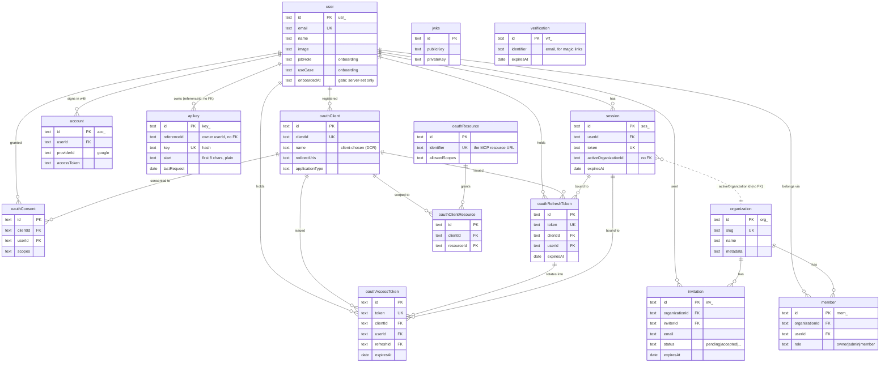

# Database schema

D1 (SQLite). Everything here is created by `migrations/`, applied with
`pnpm --filter @sequel/control-panel db:migrate`.

Two halves, and they are not equal:

- **Auth and OAuth** — 14 tables, generated by Better Auth from its plugin
  config via `db:generate`. Do not hand-edit them; the generator rewrites them.
- **The application's own data** — tasks, model enablement, asset aliases,
  embeddings. **These are not in D1.** They live in a single JSON file.

## Diagram

### Not in this diagram, because it is not in the database

`tasks`, `modelStates`, `embeddings` and `aliases` live in `.data/store.json`
— one JSON document, rewritten whole on every write. See **Known gaps** below.

## Identifiers

Stripe-style prefixes, from `packages/core/src/ids.ts` via
`advanced.database.generateId`: `usr_`, `org_`, `mem_`, `inv_`, `ses_`,
`acc_`, `key_`, `task_`. A model we have not claimed gets an unprefixed random
id rather than deferring to the database — every id column is a text primary
key with no autoincrement, so "let the database do it" means inserting NULL.

## Constraints added on top of the generated schema

`migrations/0004_integrity.sql`. All additive indexes, so the generator can
rewrite its tables without losing them. Each was enforced in application code
only, which a retry or a race bypasses:

| Index | Prevents |
| --- | --- |
| `member_org_user_uidx` | the same person joining one organisation twice |
| `invitation_org_email_pending_uidx` | two live invitations to one address (partial: `pending` only, so history survives) |
| `apikey_key_uidx` | two rows for one credential, where revoking hits whichever is found first |
| `oauthConsent_client_user_uidx` | duplicate consent rows, making "already approved?" depend on insertion order |
| `session_activeOrganizationId_idx` | — finds sessions pointing at a deleted organisation without a scan |
| `*_expiresAt_idx` (3) | — expiry sweeps scanning the whole table |

## Known gaps

**1. The application's data has no schema.** Tasks, model enablement,
embeddings and asset aliases are a single `.data/store.json`, read and
rewritten in full on every write. At 34 tasks it is already 2 MB, 1.6 MB of
which is `raw` provider payloads inlined into the same blob. There are no
indexes, no foreign keys, and no concurrent-write safety. On Workers the
filesystem is not writable, so it silently degrades to an in-memory store that
dies with the isolate.

**2. Model enablement is still global.** Tasks and spend are organisation-
scoped — a task carries `organizationId`, and every read path derives that
from the caller's credential rather than a parameter — but which models are
enabled is one list shared by every team. Disabling a model in one team
disables it everywhere.

**3. `session.activeOrganizationId` has no foreign key.** Better Auth leaves it
loose because the organization plugin is optional. Deleting an organisation
leaves live sessions pointing at a dead id.

**4. `apikey.referenceId` has no foreign key.** This one is correct: the column
is polymorphic by design (a user or an organisation, depending on config).
Worth knowing rather than fixing.

**5. `oauthClientAssertion` is a two-column table** (`id`, `expiresAt`) used as
a replay-prevention set. Not a redundancy — that is the whole job.
